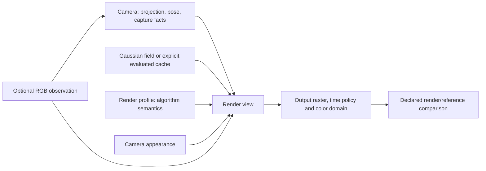

# Camera and render semantics

The design follows the information needed to reconstruct an image, inspect a
scientific result and retain the source method faithfully. It does not use a
paper's name as a rendering algorithm selector. Exact schemas live in
[Camera and rendering](RENDER_CONTRACT.md).

## Primary-source findings

| Source | Relevant finding | GSV design decision |
|---|---|---|
| [OpenUSD Camera](https://openusd.org/release/api/class_usd_geom_camera.html) | Camera geometry, optical properties, clipping and capture shutter have different units and meanings. Aperture/focal length use tenths of a scene unit, whereas focus and clipping use scene units. | Keep calibration authoritative; convert physical optical metadata explicitly into mm, and scene distances into the named GSV space. Store shutter timing independently from gain and simulated motion blur. |
| [OpenUSD RenderSettingsBase](https://openusd.org/release/user_guides/schemas/usdRender/RenderSettingsBase.html) | Output resolution, pixel aspect, image crop, camera relation and rendering overrides belong to render settings. | Use a render-view object with explicit output raster and image-plane mapping rather than changing a capture camera to suit a viewport. |
| [glTF cameras](https://github.com/KhronosGroup/glTF/blob/main/specification/2.0/Specification.adoc#cameras) | Perspective depth mapping has an explicit near plane and can omit a finite far plane. This defines a graphics projection, not every renderer's primitive filtering. | Record projection depth mapping separately from authored camera volume and Gaussian-center visibility. Represent unbounded far explicitly. |
| [OpenCV calibration](https://docs.opencv.org/4.5.1/d9/d0c/group__calib3d.html) and [fisheye](https://docs.opencv.org/4.10.0/db/d58/group__calib3d__fisheye.html) | Calibration K, resolution scaling and distortion equations have precise, distinct semantics. Brown radial/tangential and fisheye models are not interchangeable. | Require named equations and coefficient order. Resized/cropped/rectified captures need the corresponding calibrated raster; never infer distortion from the number of parameters. |
| [Blender shutter](https://docs.blender.org/manual/en/4.2/render/cycles/render_settings/motion_blur.html) | Shutter position and duration concern temporal image integration, with separate rolling behavior. | Capture timing tracks and render temporal integration are independent. Model temporal support is not a camera exposure interval. |
| [OpenEXR attributes](https://openexr.com/en/latest/StandardAttributes.html) | Capture metadata, display/data windows and color declarations coexist. Its published worldToCamera convention differs from GSV's axes. | Preserve capture facts and image-domain provenance, but convert matrices by their documented convention; copying a similarly named matrix is insufficient. |
| [OpenColorIO displays and views](https://opencolorio.readthedocs.io/en/latest/guides/authoring/displays_views.html) | Scene-referred processing and display/view transforms are separate stages. | Keep comparison RGB's declared domain independent from presentation transforms. A viewer's exposure/display preference cannot silently affect scientific image metrics. |

The decisions in the final column are GSV design choices informed by those
sources, not claims that these standards prescribe a Gaussian-splatting format.

## Direct splatting-source findings

Exporters translate the source renderer's operations into explicit profile fields.
The following distinctions matter when reproducing a calibrated view.

| Operation | Why it needs its own contract |
|---|---|
| Gaussian center depth rejection | The actual source kernel may use a different near threshold from the camera projection helper and may have no far rejection. Boundary inclusion also differs. |
| Covariance Jacobian clamp | Bounds used to stabilize derivatives do not establish a camera frustum or fragment support boundary. |
| Projected covariance dilation | A pixel-squared low-pass variance changes footprint and potentially opacity compensation; it is not a world-space Gaussian size. |
| Bounding support | Tile-major eigen-radius and opacity-aware bounds can visit different fragments, even for identical mathematical Gaussians. |
| Alpha and transmittance gates | Alpha cap, minimum contribution and whether termination occurs before a candidate contributes affect the resulting image. |
| Pixel origin | Inria-style ndc2Pix and integer pixel evaluation can match K projection with half-centered pixels; applying both corrections introduces a half-pixel error. |
| Appearance | SH activation, local-view directions, neural feature decoding and post-composite camera affine response are separate from geometric calibration. |
| Temporal support | Native 4D Gaussian temporal rejection can invalidate a source display sample without deleting its identity or redefining the mathematical covariance representation. |

The source K and chosen camera pixel convention must be analyzed together.
For example, a projected mean of `K*x - 0.5` compared with integer pixel `i`
has the same relative offset as `K*x` compared with pixel `i + 0.5`.
The render profile's explicit offset expresses any remaining conversion exactly
once; the exporter must not infer it from a variable named `cx`.

## Ownership of information

A render view chooses a concrete image recipe. Multiple views can reuse a profile
or camera, compare different reconstructions, or use different outputs. A camera
and a field need no render view to be valid independent objects. A file can also
contain only provenance, only a scaffold, or no objects at all.

The display does not own calibration. A temporary orbit view or a user-authored
camera does not overwrite an imported predicted or measured camera. Likewise an
authored far limit does not become an undocumented source Gaussian cutoff.

## Extending without changing the container

The container stores typed arrays and linked objects. A new representation,
projection model, appearance decoder or image product receives a precisely named
semantic contract when it differs mathematically. Merely changing tensor layout
is an adapter concern. Vendor-specific objects remain preservable without being
executed. Reserved core encodings are recognized and validated explicitly.

Examples of distinct extensions are orthographic/equirectangular rays, arbitrary
clip-plane sets, spectral responses, multi-layer image outputs and nonuniform
shutter integration. They must specify axes, units, evaluation and capability
requirements. They must not overload a pinhole focal length, a scalar near plane,
an RGB buffer or a single instantaneous timestamp to mean something different.

Physical optics and acquisition facts can be stored before a consumer implements
a physical camera. Storage validation, ray generation, temporal integration,
source appearance evaluation and renderer agreement are separate capabilities.
This prevents a file opening successfully from being mistaken for an exact
reproduction of its author's image formation process.

## Validation obligations

A valid file must establish object references, time/space relationships, array
shapes and numerical ranges. A calibrated comparison additionally checks exact
camera sample/view, native raster, color domain, field selection, appearance and
supported projection/time semantics. Stale asynchronous captures cannot publish
scores after any of those inputs change.

Tests therefore need unequal camera/model time axes, static cameras over moving
fields, near/far boundary cases, unbounded far, multi-field composition, mismatched
GT associations, nonidentity raster maps and unsupported optical/time effects.
Source-derived cases must additionally verify raw parameter and RGB preservation.
Renderer parity is measured independently; declaring a source profile is not
proof that an implementation matches its tile order or floating-point behavior.
