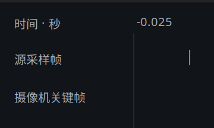
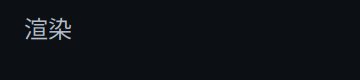
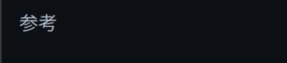

# Ubuntu 2.3.0-1 release validation

The accepted release artifact was built from clean commit
`5dfdc0ec879acbed57ea708613aa24bf2cff5c76`. Its 28 Python runtime files match
that source; subsequent validation documentation does not rebuild the tested
artifact. The application version remains 2.3.0 and the Debian revision is 1.

| Artifact | Value |
| --- | --- |
| File | `4dgs-studio_2.3.0-1_all.deb` |
| Bytes | 440478 |
| SHA256 | `f25e990879f6e5a3fca8803bbd2ebb7bf4c9d61aaf62c089c3f21c1656c2040d` |
| Author | Yifa Zhang · 张亦法 |
| Identity source | `viewer/native/Info.plist` |
| Icon source | Shared macOS/Ubuntu `viewer/Resources/AppIcon.svg` |

The retained [package provenance](validation/2026-11-17-release/package-provenance.json)
and [isolated desktop integration report](validation/2026-11-17-release/package-integration.json)
bind these exact bytes to the runtime, author, license, launch entry and icons.

## Actual desktop scaling

These checks used stock GNOME Shell/Mutter 46.2 with a private session bus,
isolated keyfile settings and its 3360×2100 virtual monitor. They ran actual
Wayland and Xwayland GTK application windows, native file dialogs, public AT-SPI
actions and Mutter EIS keyboard/pointer input. This is a real compositor with a
virtual output, not an Xvfb window test or a `GDK_SCALE` simulation.

The accepted native-font matrix used effective GTK settings Cantarell 11 at
text scale 1.0. Wayland obtained these through the private settings portal;
Xwayland obtained them from a private `gsd-xsettings`. An earlier Xwayland
pass used the effective fallback Sans 10; those additional results remain in
the reports and are not silently relabeled as Cantarell tests.

| Runtime / protocol | Desktop scales | Language coverage | Accepted checks |
| --- | --- | --- | --- |
| Source / Wayland | 100%, 125%, 150%, 175%, 200% | English and Simplified Chinese | 45/45 |
| Source / Xwayland, native XSettings | 100%, 150%, 200% | English and Simplified Chinese | 27/27 |
| Exact deb payload / Wayland | 125%, 200% | Simplified Chinese, English | 18/18 |
| Exact deb payload / Xwayland, native XSettings | 150% | Simplified Chinese | 9/9 |
| Additional source and deb Xwayland fallback-font passes | 100%, 150%, 200% source; 150% deb | English and Simplified Chinese | 36/36 |

All **135 checks across 15 application runs passed**; all 15 actual pointer
tests changed exported camera poses. Each run covered the welcome workspace,
native source opening, inspector/tab/time/timeline/viewport bounds, localized
controls, accessible time seeking, viewport and workspace snapshots, native
file-dialog Escape cancellation, visible About author/required controls,
scientific comparison export and pointer orbit. About image bounds were not
observable through AT-SPI and are not claimed as tested. The welcome icon was
visually inspected; separate branding tests check its icon-theme paintable.

See the [accepted-case summary](validation/2026-11-17-release/scaling-summary.json),
[initial source matrix](validation/2026-11-17-release/scaling-source.json),
[native XSettings source matrix](validation/2026-11-17-release/scaling-source-xsettings.json),
[deb matrix](validation/2026-11-17-release/scaling-deb.json) and
[native XSettings deb repeat](validation/2026-11-17-release/scaling-deb-xsettings.json).
All four complete reports have `passed: true`, clean starting checkouts,
unchanged runtime/source hashes, restored display configuration and exact
settings overrides, unchanged real-user `monitors.xml`, no cleanup error and
no remaining application owner. All 15 application logs were empty; their
hashes and diagnostic counts are [retained separately](validation/2026-11-17-release/application-diagnostics.json).

Desktop scale and GTK backing scale are separate observations. Wayland's
100/125/150/175/200% runs used backing scales 1/2/2/2/2. Native XSettings
Xwayland's 100/150/200% runs used backing scale 1. The runner checks actual
allocation × backing scale against PNG dimensions, without assuming that a
fractional desktop scale is an integer GTK scale. Every scientific comparison
PNG remained **1280×480**, SHA256
`33e90a717dee420ba30d10b2b2acd99f88c43535e19f2d9d74e0ff0055680378`.

Two real display defects were corrected before accepting this matrix. At
Cantarell 11, the English Document inspector tab extended three logical pixels
past its containing frame; the inspector minimum is now 320 logical pixels.
The mapped layout regression test also checks resizing, but Xvfb's default
font does not reproduce that original GNOME font-specific failure. Cairo's
toy text API also drew Chinese timeline labels as missing-glyph boxes. Native
PangoCairo now handles system font fallback and shaping for timeline and
comparison captions, preserving existing baselines, clipping and scientific
export pixels. Tests verify zero unknown glyphs, inherited font attributes,
unchanged shared widget context and 1×/2× clipping. These exact screenshot
crops were visually reviewed after the fix:

## Exact packaged runtime and integration

The [detached-payload application report](validation/2026-11-17-release/packaged-application.json)
passed all **32 application tests per backend**, with app and SDK module origins
restricted to the extracted deb tree. Xwayland actually used an NVIDIA GeForce
RTX 4090, OpenGL 4.6, driver 620.70.06. Wayland actually used Mesa 25.2.8
llvmpipe, OpenGL 4.5. The application tests mock chooser completion; the
separate scaling matrix above exercises real native dialogs and EIS input.
Neither test process left an application owner or changed the monitor state.

The host lacks the system `python3-gi-cairo` bridge. Desktop checks therefore
used the existing virtualenv with extracted Ubuntu GI/Cairo and PyOpenGL
dependencies, while importing all app and SDK code from the exact deb payload.
The deb explicitly depends on `python3-gi-cairo`; GTK's distro dependency chain
provides the Pango/PangoCairo typelibs. The first application-test harness
invocation accidentally resolved the virtualenv executable symlink to system
Python and failed before tests on this missing bridge; the retained passing
report uses the intended virtualenv interpreter and records its library paths.

Archive ownership is root:root; the launcher is executable and statically
targets system Python and `/usr/share/4dgs-studio/ubuntu`. Desktop and AppStream
validation passed. The SVG matches the canonical shared asset, and all eleven
16–512 pixel PNGs match that SVG's same-size rasterization pixel for pixel.
Temporary XDG MIME, desktop and icon databases built successfully. Fresh GIO
queries discovered the desktop entry, executable and icon and associated both
the `.gsv` suffix and GSV magic with `application/x-gsv`. Real user default
associations were unchanged. Debian compares `2.3.0-1` above the old preview
`2.3.0~ubuntu1`. Noto CJK fonts are recommended and installed by normal apt
dependency resolution; disabling recommendations without another CJK font does
not guarantee Chinese glyph availability.

This was **extracted-payload execution**, not a system-wide dpkg installation.
The current account has no passwordless sudo; proot is unavailable and both
bwrap and unshare failed user-namespace mapping. System dependency installation,
system dpkg triggers and execution through the real absolute installed launcher
were therefore not tested. Temporary database validation does not substitute
for those system-installation checks.

## Source checks and test-session recovery

All four [source CI jobs](validation/2026-11-17-release/source-ci.json) passed at
the build revision: macOS arm64, Ubuntu Desktop and the SDK on Python 3.10 and
3.14. Ubuntu ran **266 tests: 264 passed, two opt-in benchmarks skipped**; the
SDK passed 78 tests. The feature-map and localization audits passed for 80
reviewed actions and 489 keys in each language. These counts do not replace
the earlier complete workflow and [production-data validation](PRODUCTION_VALIDATION.md).

The original login GNOME Shell exited with SIGSEGV before the first post-font
application launched; that attempt supplies no accepted result. Final checks
used the isolated GNOME described above. A separate startup deadlock in that
isolated test harness was traced to PulseAudio reading X11 properties under
inherited SSH variables while Xwayland was still starting. Removing those SSH
variables allowed stock GNOME to start normally. This does not establish the
cause of the original Shell crash. Original user fractional-scaling settings
were restored; only owned test-session resources were used for the final runs.
The [final cleanup report](validation/2026-11-17-release/desktop-cleanup.json)
records all 37 owned processes exited normally, removal of their private
sockets/virtual output, global fractional features `[]` with no user override,
and unchanged real-user `monitors.xml` before/after cleanup. It does not claim
that the original login desktop was restarted.

Hardware-accelerated Wayland, physical monitors/touchpads, cross-application
exchange with a running Mac, and the previously recorded 2.56M-point Wayland
software timeout remain outside the accepted scope. No claim of physical
presentation frame rate follows from functional scaling checks.

The [retention record](validation/2026-11-17-release/retention.json) records raw
report hashes and path redaction. Screenshots use the tool's synthetic fixture,
never production data. Raw logs and generated artifacts remain local under
ignored `viewer/dist/release-validation/`.
